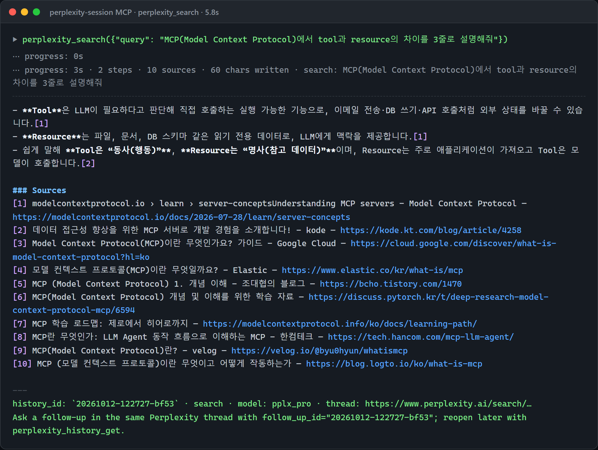
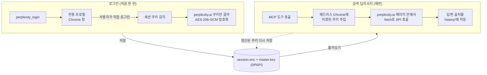
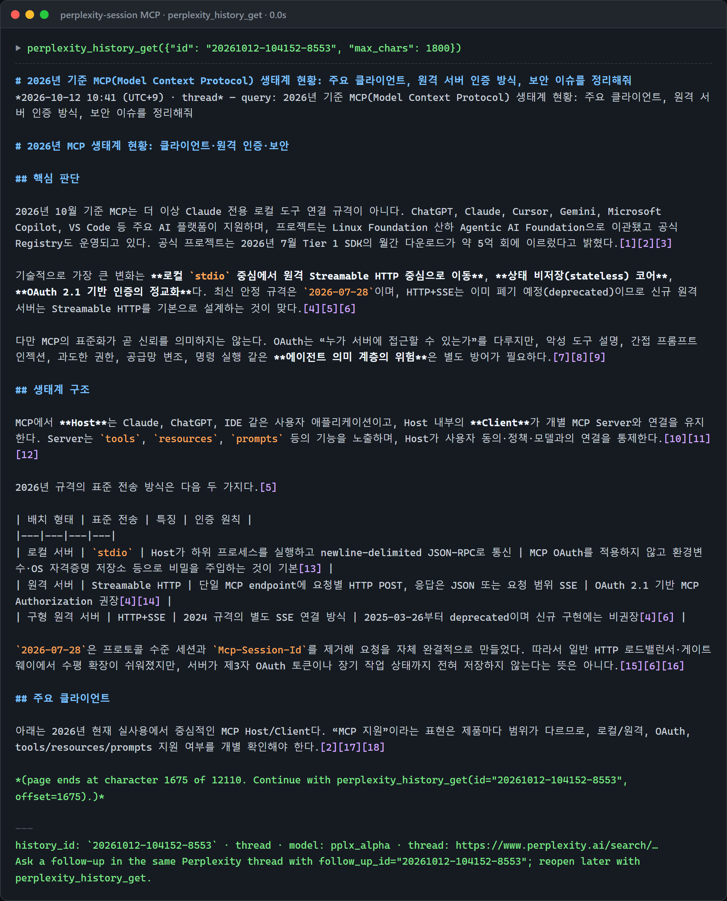
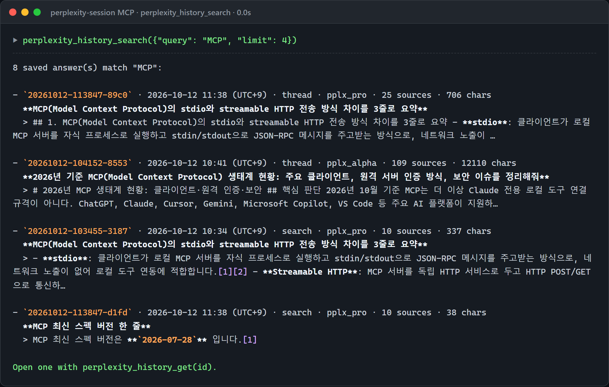

# Perplexity Session MCP

내 Perplexity 계정에 로그인한 **브라우저 세션**으로 검색·딥리서치를 쓰는 MCP 서버입니다. API 키가 필요 없고, Pro 요금제라면 Pro Search·Deep Research 할당량을 그대로 씁니다.
Claude Code·Codex·Cursor·Claude Desktop 같은 MCP 클라이언트에 붙여 씁니다.



*stdio MCP 클라이언트로 `perplexity_search`를 실제로 호출한 결과입니다(5.8초). 스레드 주소는 가렸습니다.*

[빠른 시작](#빠른-시작) · [로그인과 세션](#로그인과-세션) · [클라이언트 등록](#mcp-클라이언트-등록) · [도구](#도구) · [사용 예](#사용-예) · [데이터와 보안](#데이터와-보안) · [동작 원리](#동작-원리)

> Perplexity의 공개 API가 아니라 웹 앱이 쓰는 내부 API를 호출하는 비공식 도구입니다. 사이트가 바뀌면 깨질 수 있습니다.

---

## 주요 기능

- **로그인 세션 저장** — 브라우저 창에서 직접 로그인(이메일 코드·Google·Apple·SSO)하면 세션 쿠키를 암호화해 저장하고 계속 재사용합니다. 쓰는 동안 바뀐 쿠키도 다시 저장합니다.
- **검색** — 출처 번호가 달린 웹 답변. 유료 요금제면 Pro Search, 모델 지정·학술/소셜 소스·기간 필터·후속 질문을 지원합니다.
- **딥리서치** — 몇 분 걸리는 장문 보고서를 **전문 그대로**(요약이 아니라 보고서 원문) 받아 옵니다. 진행률을 알려 주고, 대기 시간을 넘기면 `job_id`를 돌려줘 나중에 받을 수 있습니다. 연결이 끊기거나 서버가 재시작돼도 Perplexity 스레드에서 결과를 복구합니다.
- **응답 검색·활용** — 모든 답변을 로컬에 저장(JSON + Markdown)하고 전문 검색합니다. 웹·앱에서 만든 Perplexity 라이브러리 스레드도 찾아 불러오고, 저장된 답변에 이어서 후속 질문을 합니다.
- **긴 응답 나눠 읽기** — 클라이언트 출력 한도에 맞춰 한 페이지씩 돌려주고, 다음 페이지를 읽는 호출을 끝에 적어 줍니다.

## 빠른 시작

준비물: [Node.js](https://nodejs.org/) **22.18 이상**(TypeScript 소스를 빌드 없이 바로 실행), Google Chrome(없으면 Edge, 둘 다 없으면 `npx patchright install chromium`).

```bash
git clone https://github.com/cyKim0115/Perplexity-MCP.git
cd Perplexity-MCP
npm install
npm run login     # Chrome 창이 열리면 Perplexity에 로그인 → 창이 저절로 닫힘
npm run status    # 로그인 계정·요금제·남은 Pro Search·Research 횟수
```

그다음 [쓰는 클라이언트에 등록](#mcp-클라이언트-등록)합니다. 클라이언트 안에서 `perplexity_login` 도구를 불러도 같은 로그인 창이 열립니다.

## 로그인과 세션

`npm run login`(또는 `perplexity_login`)을 실행하면 **확장도 북마크도 Google 로그인도 없는 Chrome 창**이 뜹니다.
게스트 창처럼 보이지만 Chrome 게스트 모드가 아니라, 이 도구 전용 프로필(`~/.perplexity-session-mcp/login-profile/`)로 띄운 실제 Chrome입니다.
평소 쓰는 Chrome 프로필이나 그 쿠키는 읽지 않습니다.



1. 로그인 창은 perplexity.ai가 Cloudflare 확인을 통과할 때까지 기다린 뒤 로그인을 기다립니다(기본 5분).
2. 세션 쿠키가 생기면 로그인 팝업까지 포함해 모든 perplexity.ai 탭에서 로그인된 계정을 확인합니다.
3. perplexity.ai 쿠키와 localStorage만 골라 암호화해 저장합니다. Cloudflare 쿠키(`cf_clearance` 등)는 그 브라우저 지문에 묶여 있어서 옮기지 않습니다.
4. 실제 검색은 별도의 헤드리스 Chrome이 저장된 쿠키로 합니다. 로그인 창의 프로필은 남겨 두므로 다음 재로그인은 대개 클릭 한 번입니다.

여러 클라이언트가 동시에 서버를 띄워도 세션 파일 하나를 함께 씁니다. 한쪽에서 다시 로그인하면 나머지가 다음 호출 때 새 쿠키로 바꿔 끼웁니다.
Windows에서 세션 파일은 DPAPI로 현재 사용자에게 묶여 있어 **다른 PC로 복사해도 풀리지 않습니다.** 새 PC에서는 `npm run login`을 한 번 실행하세요.

## MCP 클라이언트 등록

아래 경로는 이 저장소를 받은 위치로 바꿔 주세요. 클라이언트가 nvm 등으로 설치한 `node`를 찾지 못하면 `node` 대신 절대 경로(`where node` 결과)를 씁니다.

**Claude Code**

```bash
claude mcp add perplexity-session -s user -- node C:/Users/<you>/repo/Perplexity-MCP/src/index.ts
```

**Codex** (`~/.codex/config.toml`)

```toml
[mcp_servers.perplexity-session]
command = "node"
args = [ "C:\\Users\\<you>\\repo\\Perplexity-MCP\\src\\index.ts" ]
startup_timeout_sec = 60
tool_timeout_sec = 3700   # 딥리서치 대기(최대 3600초)보다 길게
```

**Cursor** (`~/.cursor/mcp.json`) / **Claude Desktop** (`claude_desktop_config.json`)

```json
{
  "mcpServers": {
    "perplexity-session": {
      "command": "node",
      "args": ["C:/Users/<you>/repo/Perplexity-MCP/src/index.ts"]
    }
  }
}
```

딥리서치는 몇 분 걸립니다. `perplexity_research`는 기본 600초(`wait_seconds`)까지 기다리고, 그 안에 끝나지 않으면 `job_id`를 돌려줍니다.
클라이언트의 도구 타임아웃이 더 짧다면 `wait_seconds`를 줄이거나 타임아웃을 늘리세요(Claude Code는 `MCP_TOOL_TIMEOUT`, 밀리초).
호출이 중간에 끊겨도 작업은 계속되며 `perplexity_research_status`(job_id 없이 부르면 작업 목록)로 이어 받습니다. 같은 질문을 다시 보내면 새로 시작하지 않고 실행 중인 작업에 붙습니다.

## 도구

| 도구 | 하는 일 |
| --- | --- |
| `perplexity_login` | 로그인 창을 열어 로그인하고 세션을 저장 |
| `perplexity_logout` | 저장된 세션 삭제 (옵션: 로그인 프로필·암호화 키까지 초기화) |
| `perplexity_account` | 로그인 계정·요금제·남은 할당량 |
| `perplexity_models` | `model` 인자로 쓸 수 있는 모델 id 목록 |
| `perplexity_search` | 검색 답변 + 출처. `style`(auto/fast/pro), `model`, `sources`(web/scholar/social), `recency`, `follow_up_id`, `max_chars` |
| `perplexity_research` | 딥리서치. 결과는 **보고서 전문**(Markdown)과 요약. `wait_seconds` 안에 끝나지 않으면 `job_id` 반환 |
| `perplexity_research_status` | 딥리서치 진행 상황·완료 보고서. 서버 재시작·스트림 끊김으로 놓친 작업도 Perplexity 스레드에서 복구 |
| `perplexity_history_search` | 저장된 답변 전문 검색 (한국어 부분 일치, "따옴표 구문", 종류·날짜 필터) |
| `perplexity_history_get` | 저장된 답변 전체 보기 (긴 보고서는 `offset`으로 이어 읽기, `sources_only`로 전체 출처 목록) |
| `perplexity_library_search` | perplexity.ai 라이브러리(웹·앱에서 만든 스레드 포함) 검색 |
| `perplexity_thread_get` | 라이브러리 스레드 전체 불러오기(딥리서치는 보고서 전문) + 로컬 히스토리에 저장 |

리소스 `perplexity-history://{id}`로 저장된 답변을 Markdown 그대로 첨부할 수도 있습니다.

## 사용 예

### 딥리서치 보고서 이어 읽기

딥리서치 보고서(이 예는 12,110자·출처 109개)는 한 페이지씩 돌아오고, 끝에 다음 페이지를 읽는 호출이 적혀 있습니다.
출처가 많으면 본문에 인용된 출처만 원래 번호로 보여 주고, 전체 목록은 `sources_only`로 따로 받습니다.



### 저장된 답변 검색

검색·딥리서치·불러온 스레드는 모두 로컬 히스토리에 쌓이고, 질문과 답변 본문에서 찾습니다. 모든 단어가 들어간 답변이 없으면 일부만 맞는 답변을 보여 줍니다.



### 후속 질문

모든 답변 끝에 `history_id`가 붙습니다. `perplexity_search`/`perplexity_research`에 `follow_up_id`로 넘기면 같은 Perplexity 스레드에서 이어서 묻습니다.
라이브러리 스레드 URL이나 slug를 넘겨도 됩니다.

### 긴 응답

긴 응답은 클라이언트 출력 한도(Claude Code 기본 약 25k 토큰)에 맞게 한 페이지(약 16k 토큰, 한글은 글자당 1토큰으로 계산)로 나뉩니다. 분량은 `max_chars`나 `PPLX_MAX_OUTPUT_TOKENS`로 조절합니다.

## CLI

MCP 클라이언트 없이 터미널에서도 씁니다.

```bash
node src/index.ts status
node src/index.ts search "질문"
node src/index.ts research "조사 주제"
node src/index.ts history "검색어"
node src/index.ts logout [--wipe]
```

## 데이터와 보안

모든 데이터는 `~/.perplexity-session-mcp/`(환경 변수 `PPLX_MCP_HOME`으로 변경)에 있습니다. 이 폴더는 저장소 밖이며 커밋되지 않습니다.

| 경로 | 내용 |
| --- | --- |
| `session.enc` | 세션 쿠키. AES-256-GCM 암호화 |
| `master.key` | 암호화 키. Windows에서는 DPAPI(현재 사용자)로 보호되어 다른 계정·PC에서는 풀 수 없습니다. 그 밖의 OS에서는 0600 파일입니다 |
| `login-profile/` | 로그인 창 전용 브라우저 프로필. 이 안에도 로그인 상태가 남아 있습니다 |
| `history/` | `index.jsonl`, `entries/<id>.json`, `md/<id>.md`(사람이 읽는 사본) |
| `jobs/` | 딥리서치 작업 상태 (서버가 재시작돼도 결과를 복구) |
| `account.json` | 요금제·모델 목록 캐시 |

완전히 로그아웃하려면 `node src/index.ts logout --wipe`로 `login-profile/`과 `master.key`까지 지웁니다.

## 동작 원리

Perplexity 웹 API(`/rest/sse/perplexity_ask` 등)는 Cloudflare 뒤에 있어 일반 HTTP 요청은 막힙니다.
그래서 [patchright](https://github.com/Kaliiiiiiiiii-Vinyzu/patchright)로 실제 Chrome을 헤드리스로 띄우고, 저장된 쿠키를 넣은 perplexity.ai 페이지 **안에서** `fetch`를 호출합니다.

- 헤드리스 Chrome은 User-Agent의 `HeadlessChrome`을 일반 Chrome 표기로 바꿉니다. 그대로 두면 Cloudflare가 `/rest/*`를 계속 막습니다. 그래도 막히면 화면 밖 창으로 한 번 더 시도합니다.
- 스트리밍 응답은 페이지 안에 쌓고 Node 쪽에서 주기적으로 가져와 진행률을 보고합니다. 응답의 블록과 JSON Patch(`diff_block`)를 그대로 적용해 웹 화면과 같은 답변을 복원합니다.
- 딥리서치 보고서 전문은 스레드의 보고서 첨부(`RESEARCH_REPORT`)에서 받아 옵니다.
- 브라우저는 첫 호출 때 뜨고 10분간 쓰지 않으면 닫힙니다.

## 환경 변수

| 변수 | 기본값 | 설명 |
| --- | --- | --- |
| `PPLX_MCP_HOME` | `~/.perplexity-session-mcp` | 데이터 폴더 |
| `PPLX_HEADLESS` | `1` | `0`이면 작업용 브라우저를 화면 밖 창으로 띄움 (Cloudflare가 헤드리스를 막을 때) |
| `PPLX_BROWSER_PATH` | | 브라우저 실행 파일 직접 지정 |
| `PPLX_IDLE_CLOSE_MS` | `600000` | 유휴 시 브라우저 종료까지 시간 (0이면 유지) |
| `PPLX_LANGUAGE` | `en-US` | Perplexity에 보내는 로캘 |
| `PPLX_SEARCH_MODEL` | `pplx_pro` | 유료 요금제 기본 검색 모델 |
| `PPLX_RESEARCH_MODEL` | `pplx_alpha` | 딥리서치 모델 |
| `PPLX_ASK_TIMEOUT_MS` | `2400000` | 딥리서치 한 건의 최대 스트림 대기 시간 (검색은 5분과 이 값 중 작은 쪽) |
| `PPLX_MAX_OUTPUT_TOKENS` | `16000` | 한 번에 돌려주는 답변 분량(대략의 토큰 수) |
| `PPLX_DEBUG` | | `1`이면 원본 SSE를 `debug/`에 저장 |

## 개발

```bash
npm test             # 파서·스트림 복구·히스토리·포맷 단위 테스트
npm run typecheck
node scripts/smoke-client.mjs '[["perplexity_account",{}]]'   # 실제 MCP 클라이언트처럼 stdio로 호출
node scripts/parse-sse.ts <capture.sse>                        # PPLX_DEBUG=1로 저장한 스트림 재해석
```

딥리서치는 하루 횟수가 적으니, 파서를 고칠 때는 새로 호출하기보다 저장해 둔 스트림으로 확인하세요.

## 주의

Perplexity 이용 약관의 범위 안에서 **본인 계정으로만** 쓰세요. 세션 파일·키·로그인 프로필은 남에게 넘기거나 공유하지 마세요.

## 라이선스

[MIT](LICENSE)
